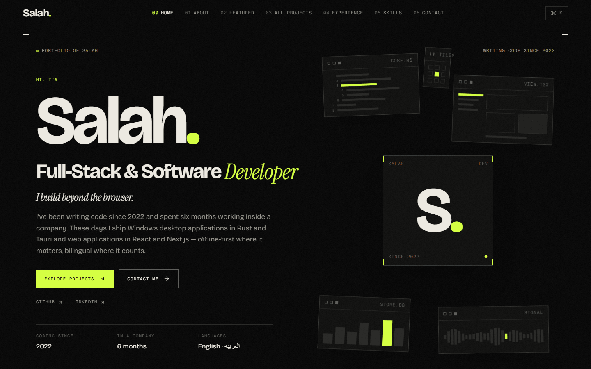
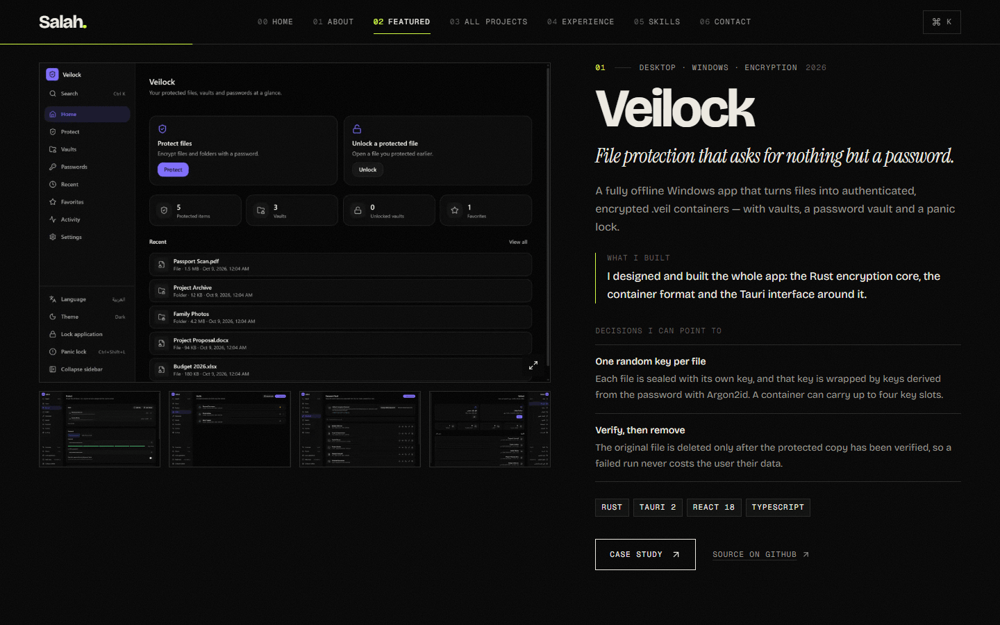
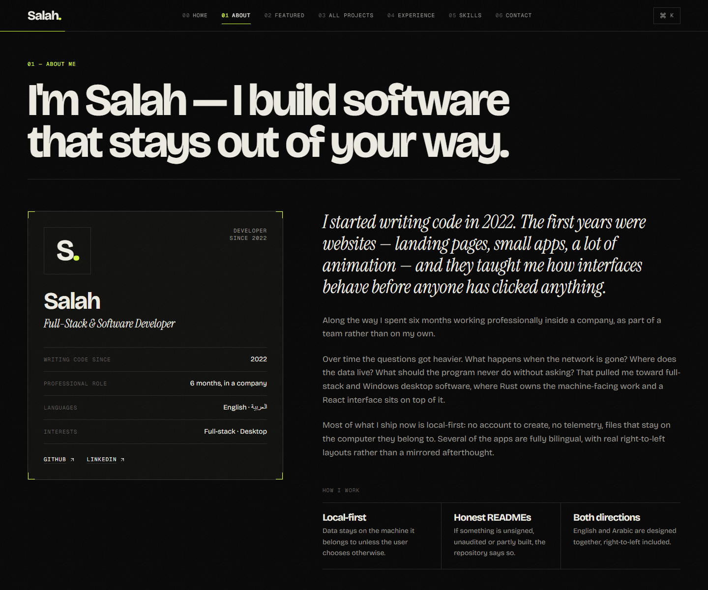

<div align="center">

# SALAH / UNBOUND

**Beyond Code. Built to Stand Out.**

A single-page developer portfolio for Salah: full-stack, web and software developer.<br />
Dark, minimal and typographic, with one acid-lime accent and live project data from GitHub.

<p>
  
  
  
  
  
  
  
</p>

<p>
  <a href="https://github.com/salah-alstre"><strong>GitHub</strong></a>
  &nbsp;·&nbsp;
  <a href="https://www.linkedin.com/in/salah-alden-8aba5a322/"><strong>LinkedIn</strong></a>
</p>

<br />



</div>

<br />

## Overview

SALAH / UNBOUND is a personal portfolio, not a template. It introduces Salah by name, says plainly what he builds
(Windows desktop software in Rust and Tauri, web applications in React and Next.js) and backs it with real
repositories: eleven written-up case studies and an explorer that lists every public repository straight from GitHub.

Design principles:

- **Typographic and quiet.** A Swiss grid on near-black, warm paper-coloured text, one accent (`#d4ff3f`).
- **Normal document flow.** No pinned sections and no horizontal scroll takeovers, so nothing overlaps and the fixed
  navigation never covers a heading.
- **Honest content.** Real project screenshots only. Anything not yet supplied is marked as a placeholder, not invented.
- **Resilient data.** GitHub being slow, rate-limited or down never breaks the page.

## Website Preview

<div align="center">
  
</div>

<br />

<div align="center">
  
</div>

<p align="center"><sub>Captured from the production build at 1440 px wide. Regenerate them with <code>npm run screenshots</code>, see <a href="#regenerating-the-screenshots">below</a>.</sub></p>

## Features

**Page**

- Hero with an identity block and a decorative scene of software windows. On a mouse or trackpad the windows can be
  dragged out of the frame, with an "Unbound" counter and a reset button.
- About, Featured Projects, All Projects, Experience, Skills and Contact, all in one scrolling page.
- Featured Projects: long-form case studies with what was built, the decisions behind it, the tech stack, and links to
  the source. Each case study opens in a dialog.
- All Projects: a GitHub-backed explorer with category filters, search, sorting and "load more".
- Screenshot viewer (lightbox) with Fit and Actual-size modes and arrow-key stepping. Images are shown whole, never
  cropped.
- Command palette on `Ctrl/Cmd + K`, scroll-spy navigation and a scroll-progress line.

**Engineering**

- Server-side GitHub fetching with ISR, a committed offline snapshot, and secrets that never reach the browser.
- Metadata, canonical URL, Open Graph and Twitter cards, JSON-LD (`Person`), `sitemap.xml`, `robots.txt`, a generated
  favicon and generated 1200×630 social images.
- Accessibility: semantic landmarks, skip link, visible focus states, focus-trapped dialogs that close on `Esc` and
  return focus, and full support for `prefers-reduced-motion`.
- Readable with JavaScript disabled.
- Responsive from 375 px phones to 1920 px desktops.

## Technology Stack

| Concern | Choice |
| --- | --- |
| Framework | Next.js 16 (App Router, Turbopack), React 19 |
| Language | TypeScript 5.9, strict |
| Styling | Tailwind CSS 4 |
| Motion | GSAP 3 with ScrollTrigger, ScrollToPlugin and Draggable via `@gsap/react` (the only animation system) |
| Icons | `lucide-react` |
| Fonts | `next/font/google`: Bricolage Grotesque, Instrument Serif, Geist Mono, Noto Sans Arabic |
| Data | GitHub REST API, fetched on the server and cached with ISR |
| Images | `next/image`, optimised WebP project screenshots (`sharp` at build-prep time) |
| Quality | ESLint 9 (flat config), `tsc --noEmit`, Playwright (Chromium + WebKit) |
| Runtime | Node.js 20.9 or newer |

No Three.js and no smooth-scroll library: nothing in the design needed them.

## Project Architecture

```text
.
├─ docs/
│  └─ screenshots/        README images: hero.png, projects.png, portfolio.png
├─ public/
│  └─ projects/           optimised project screenshots (WebP)
├─ scripts/
│  ├─ fetch-assets.mjs        download and convert the reviewed project screenshots
│  ├─ snapshot-github.mjs     refresh the offline GitHub snapshot
│  ├─ capture-readme-shots.mjs  regenerate docs/screenshots
│  └─ qa.mjs                  end-to-end checks
├─ src/
│  ├─ app/                layout, page, sitemap, robots, icons, social images, error and 404
│  ├─ components/
│  │  ├─ motion/          GSAP setup, MotionRoot, SplitWords
│  │  ├─ layout/          Nav, CommandPalette, SiteShell, Footer
│  │  ├─ hero/            Hero, HeroScene
│  │  ├─ work/            SelectedWork (Featured Projects), ProjectDialog
│  │  ├─ explorer/        Explorer (All Projects)
│  │  ├─ sections/        About, Experience, Skills, Contact
│  │  └─ ui/              SectionHead, Lightbox, TechChips, ExternalLink
│  ├─ content/            all copy and curated data
│  └─ lib/
│     ├─ github/          client, normalize, classify, repos, readme-images, fallback.json
│     ├─ format.ts
│     └─ shots.ts
├─ .env.example
├─ next.config.ts
└─ package.json
```

## Getting Started

Requires **Node.js 20.9+**.

```bash
npm install
cp .env.example .env.local   # optional, see Environment Variables
npm run dev                  # http://localhost:3000
```

Production build:

```bash
npm run build
npm start
```

| Script | What it does |
| --- | --- |
| `npm run dev` | Development server |
| `npm run build` / `npm start` | Production build and server |
| `npm run typecheck` | `tsc --noEmit` |
| `npm run lint` | ESLint |
| `npm run assets` | Re-download the reviewed project screenshots listed in `scripts/fetch-assets.mjs` and convert them to WebP in `public/projects/` |
| `npm run snapshot` | Rewrite `src/lib/github/fallback.json` from the live GitHub API |
| `npm run qa` | End-to-end checks against a running production server, see [Testing](#testing) |
| `npm run screenshots` | Regenerate the README screenshots |

## Environment Variables

Copy `.env.example` to `.env.local`. Both variables are optional for local development. Never commit `.env.local`
(it is git-ignored).

| Name | Required | Purpose |
| --- | --- | --- |
| `GITHUB_TOKEN` | No | A read-only token (no scopes needed for public data). Raises the GitHub API limit from 60 to 5,000 requests per hour. **Server-only:** it is read in server code and must never be prefixed with `NEXT_PUBLIC_`. |
| `NEXT_PUBLIC_SITE_URL` | Recommended in production | Canonical origin used for metadata, sitemap, robots and social images, for example `https://your-domain.com`. |

If `NEXT_PUBLIC_SITE_URL` is not set, the site uses `VERCEL_PROJECT_PRODUCTION_URL` when deployed on Vercel, and
`http://localhost:3000` otherwise. Set it explicitly once you have a custom domain.

## GitHub Integration

Code lives in `src/lib/github/`.

- **Fetch.** Repositories come from `GET /users/salah-alstre/repos` on the server, paginated by following the `Link`
  header. The optional `GITHUB_TOKEN` is sent only from server code.
- **Cache.** Requests use ISR (`revalidate = 3600`, cache tag `github`), so the page stays static-fast and refreshes
  at most hourly.
- **Curate.** Forks, private repositories and any name in `site.github.hiddenRepos` are filtered out. Each remaining
  repository is classified by language and topics. Curated data in `projects.ts` and `archiveOverrides` always wins
  over what GitHub returns.
- **Screenshots.** Only authentic repository images are used, resolved from each README (relative paths included)
  through `raw.githubusercontent.com`. A repository without a usable image gets a typographic card, never a fake UI.
  `next.config.ts` allows only `raw.githubusercontent.com/salah-alstre/**`.
- **Fail soft.** `getRepos()` never throws. On a network error, rate limit (403/429), bad token (401) or malformed
  response it serves the committed snapshot (`fallback.json`), and the Explorer labels the source "Snapshot" instead
  of "Live from GitHub".
- **Update.** New public repositories appear after the next revalidation. Run `npm run snapshot` now and then to
  refresh the offline fallback.

## Deployment on Vercel

The project is a standard Next.js app: no `vercel.json` and no special build settings are needed.

1. Push the project to a GitHub repository.
2. In Vercel choose **Add New → Project** and import the repository. The Next.js preset is detected automatically.
3. Under **Settings → Environment Variables** add:
   - `NEXT_PUBLIC_SITE_URL`: your final origin (recommended)
   - `GITHUB_TOKEN`: optional, to raise the API limit
4. Deploy. After attaching a custom domain, update `NEXT_PUBLIC_SITE_URL` to match and redeploy.

The token stays on the server and is never part of the client bundle.

## Customization

Everything the page says lives in `src/content/`.

| File | What it controls |
| --- | --- |
| `site.ts` | Name, tagline, navigation, hero, About and Contact copy, social links, contact email, start year, hidden repositories |
| `projects.ts` | Case studies. Entries with `featured: true` appear, in file order, in Featured Projects (the first three get the long layout) |
| `categories.ts` | Explorer filters and `archiveOverrides` (category, tagline, featured, `noPreview`) per repository name |
| `skills.ts` | The six skill categories |
| `experience.ts` | The Experience timeline |
| `types.ts` | Shared content types |

**Personal info and social links.** Edit `site.ts`. GitHub, LinkedIn and Instagram links are in `site.links`.

**Adding a project.** Push a public repository to the GitHub account and it appears in the Explorer on the next
revalidation. To control how it appears, add an `archiveOverrides` entry. To give it a full case study, add it to
`projects.ts` with `featured: true`.

**Assets.** Project screenshots live in `public/projects/` as WebP and are listed in `scripts/fetch-assets.mjs`. Add
the source image there and run `npm run assets`.

**Still to fill in**

- **Company experience.** The entry in `src/content/experience.ts` (`id: "company"`) is a marked placeholder: the
  company name and dates were not supplied, so nothing was invented. Replace `[ Company name to be added ]` and
  `[ Dates to be added ]`, update the text and remove `placeholder: true`.
- **CV.** There is deliberately no CV button yet. Add the real PDF to `public/` (for example `public/salah-cv.pdf`)
  and link it from `Hero.tsx` and/or `Contact.tsx`.
- **Photo.** The identity element is a branded "S." monogram. To use a photo, add it to `public/` and replace
  `Monogram` in `HeroScene.tsx` and `About.tsx`.

### Regenerating the screenshots

```bash
npm run build
npx next start -p 3100            # in one terminal
npm run screenshots -- http://localhost:3100   # in another
```

This drives Chromium with Playwright at 1440 px wide, waits for fonts, images and animations, and writes pure page
pixels (no browser chrome) to `docs/screenshots/`. Pass `hero`, `projects` or `portfolio` after the URL to regenerate
a single image. If you change the page, check the new frames by eye before committing them.

## Testing

`npm run qa` runs `scripts/qa.mjs` against a running production server:

```bash
npm run build
npx next start -p 3100 &
npm run qa -- http://localhost:3100
```

Chromium runs at 1920×1080, 1440×900, 1366×768, 768×1024, 390×844 and 375×667; WebKit at 1440×900, 768×1024 and
390×844. It checks, among other things: one `h1`, no horizontal overflow, section and text overlap at every scroll
step, image cropping, every navigation item and hash reload, Explorer filters, search and load-more, the screenshot
viewer, dialog layering and focus return, the command palette, reduced motion, the no-JavaScript fallback, external
links and console errors. The last full run passed 372 of 372 checks.

Known limits: LinkedIn answers automated requests with HTTP 999, so that one link cannot be verified by script, and
Playwright's WebKit never Tabs to links, so WebKit focus order is checked by DOM order only. Real Safari, physical
phones and screen readers are not covered.

## About the Developer

I'm Salah, a full-stack and software developer. I started writing code in 2022, beginning with websites and
animation, and spent six months working professionally inside a company as part of a team. Today I build Windows
desktop applications (Rust and Tauri with a React interface) and web applications (React and Next.js). Most of what I
ship is local-first, and several of the apps are fully bilingual in English and Arabic, with real right-to-left
layouts.

## Connect

| | |
| --- | --- |
| GitHub | [github.com/salah-alstre](https://github.com/salah-alstre) |
| LinkedIn | [linkedin.com/in/salah-alden-8aba5a322](https://www.linkedin.com/in/salah-alden-8aba5a322/) |

<br />

<div align="center">

<sub>SALAH / UNBOUND &nbsp;·&nbsp; Beyond Code. Built to Stand Out. &nbsp;·&nbsp; Designed and built by Salah</sub>

</div>
